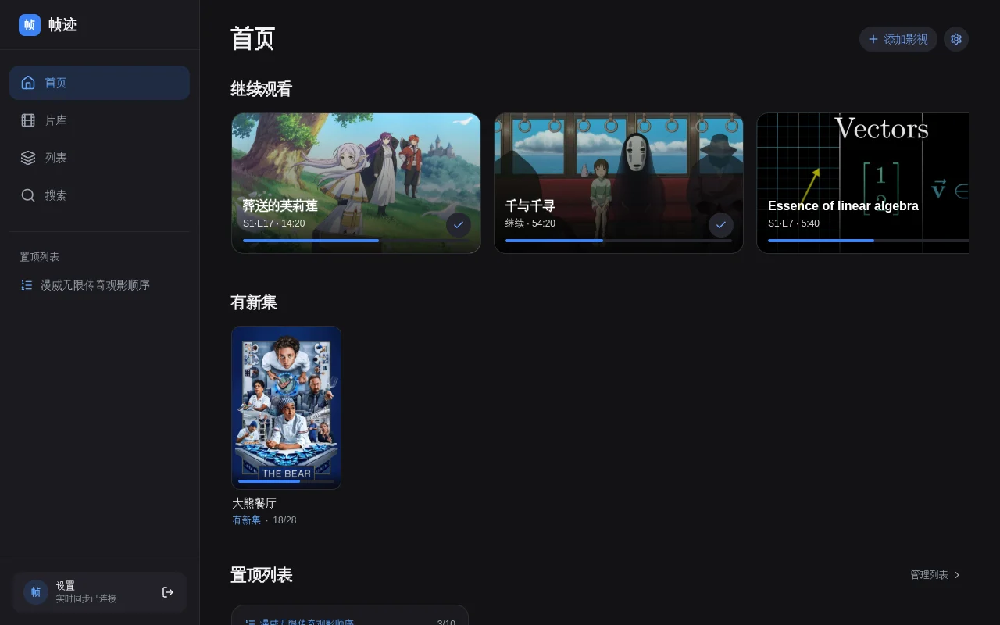
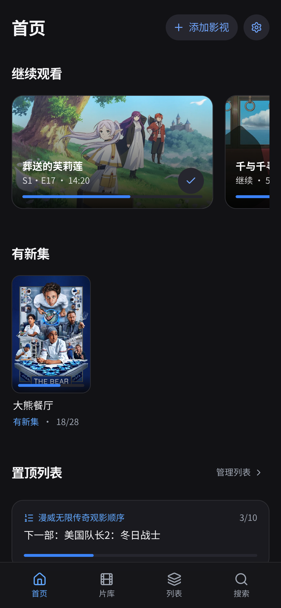
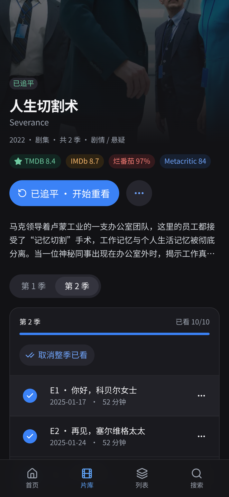
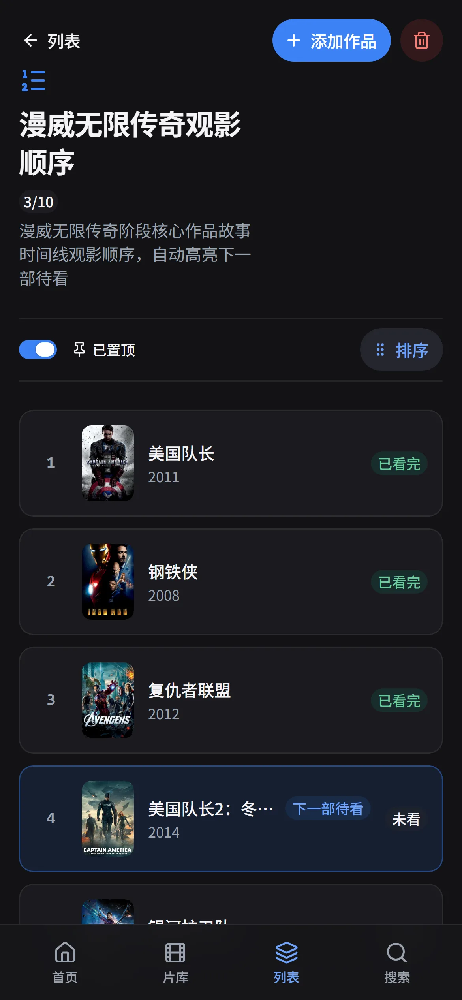
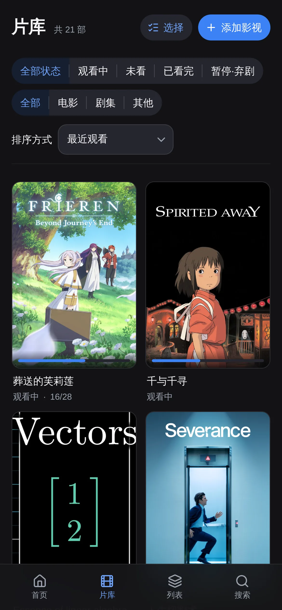
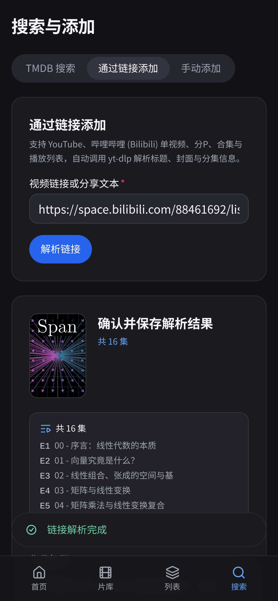
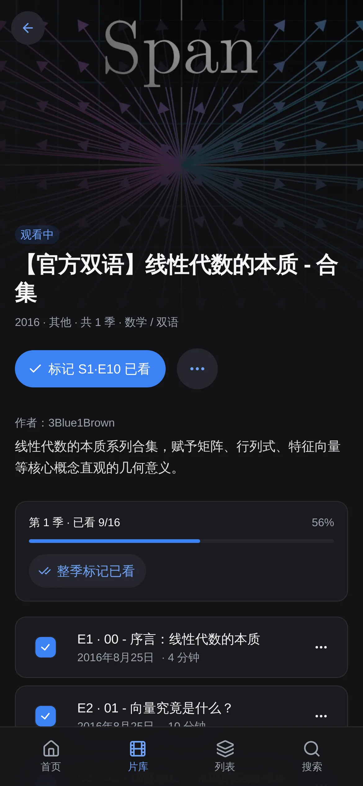
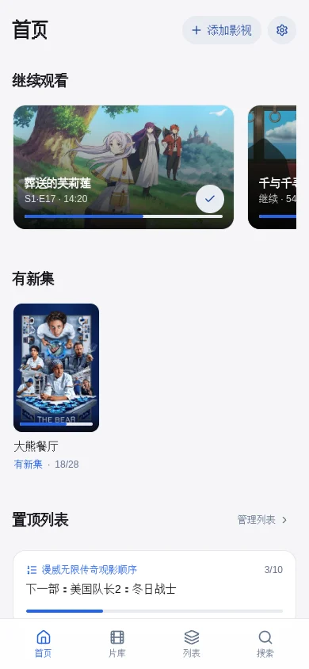
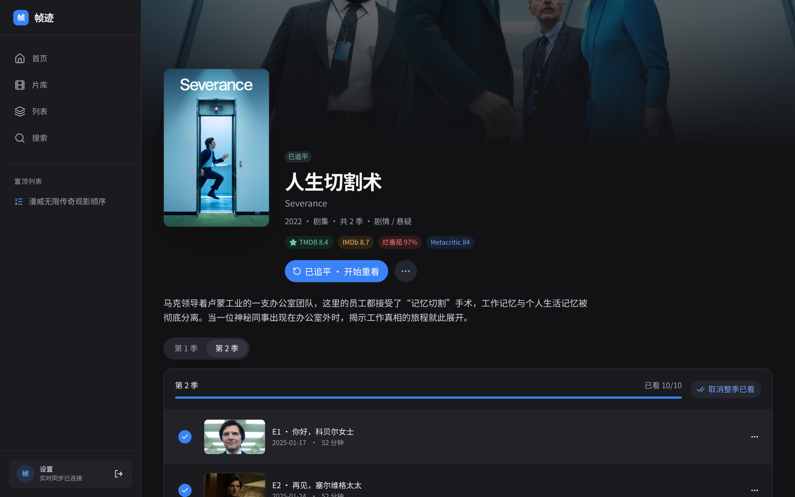

<div align="center">

# 帧迹 Zhenji

**A personal, self-hosted movie & TV watch progress tracker — cinematic interface, single-folder portable storage, and real-time multi-device sync.**

[](https://nodejs.org/)
[](https://react.dev/)
[](https://heroui.com/)
[](https://www.typescriptlang.org/)
[](https://nodejs.org/api/sqlite.html)
[](./Dockerfile)
[](./LICENSE)

[简体中文](./README.md) | **English**

<br />

<picture>
  <source media="(prefers-color-scheme: light)" srcset="docs/screenshots/desktop-home-light.webp" />
  <source media="(prefers-color-scheme: dark)" srcset="docs/screenshots/desktop-home.webp" />
  
</picture>

</div>

## Screenshots

### Episode Tracking

<table>
  <tr>
    <td align="center">
      <br />
      <sub>Home (Continue Watching &amp; New Episodes)</sub>
    </td>
    <td align="center">
      <br />
      <sub>Title Detail &amp; Episode Checklist</sub>
    </td>
  </tr>
</table>

### Watch Lists & Library

<table>
  <tr>
    <td align="center">
      <br />
      <sub>Ordered Watch List (Next Up Highlighted)</sub>
    </td>
    <td align="center">
      <br />
      <sub>Library Poster Grid</sub>
    </td>
  </tr>
</table>

### Link Import

<table>
  <tr>
    <td align="center">
      <br />
      <sub>Link Import Playlist Preview</sub>
    </td>
    <td align="center">
      <br />
      <sub>Imported Playlist Detail &amp; Episodes</sub>
    </td>
  </tr>
</table>

### Dark & Light Themes

<table>
  <tr>
    <td align="center">
      <br />
      <sub>Dark Theme (Default)</sub>
    </td>
    <td align="center">
      <br />
      <sub>Light Theme</sub>
    </td>
  </tr>
</table>

<details>
<summary>More Screenshots (Desktop Detail View)</summary>
<br />
<p align="center">
  
</p>
</details>

## Features

### Episode & Movie Tracking
- **Automatic Watch Status**: Titles are automatically organized into *Unaired*, *Unwatched*, *Watching*, *Caught Up*, or *Completed*, and can be manually marked as *Paused* or *Dropped* at any time.
- **New Episode Alerts**: When you catch up on an airing series, its status becomes *Caught Up* (`已追平`). As soon as a new episode airs, it returns to *Watching* with a **New Episodes (`有新集`)** badge.
- **Effortless Episode Checklists**: Check off individual episodes, mark or unmark an entire season at once, use **Mark up to here** to check every aired episode up to the selected one without unchecking later episodes, or mark the entire title watched. Future unaired episodes show their air date and are disabled against accidental taps.
- **Resume Timestamps**: Save where you left off in a movie or episode (e.g., `S2·E5 · 42:15`) so you can pick up right from the Home screen; checking that episode watched clears the timestamp automatically.
- **Rewatch History & Full Undo**: Start a rewatch (`二刷中`) on any completed or caught-up title while keeping a full history of start and completion dates. Undo the latest playthrough step by step all the way back to *Unwatched*, or delete any individual playthrough from the history.

### Watch Lists & Collections
- **Ordered Watch Lists**: Build numbered watch orders (such as the *Marvel Infinity Saga* order) that automatically highlight the first unwatched entry (`下一部待看`) and display your next movie and overall progress right on the Home screen when pinned.
- **Poster Collections**: Group titles into collections (such as *Weekend Watchlist*) with sorting by date added, title, release year, rating, or manual drag-and-drop order.

### Flexible Ways to Add Titles
- **TMDB Search**: Search movies, TV series, and anime in Chinese, English, or original title. Automatically fetches bilingual titles, overviews, posters, backdrops, seasons, and air dates, and displays **TMDB** ratings alongside **IMDb**, **Rotten Tomatoes**, and **Metacritic** scores.
- **Link Import for Videos & Playlists**: For web series, courses, or playlists not on TMDB, paste a URL or share text from YouTube, Bilibili, and other sites. Single videos and multi-part playlists/collections are parsed into trackable episodes, with one-tap **Refresh Playlist** to append newly published videos later. If an anime or TV show link is detected, the app offers a one-tap shortcut to search TMDB instead.
- **Manual Entry**: Add custom movies, series, or videos with your own title, poster URL, and episode count.

### Multi-Device Experience & Portable Data
- **Designed for Phone, Tablet & Desktop**: Bottom navigation bar and action drawers on phones, navigation rail on tablets, and a full sidebar with pinned lists on desktop. Installable to your phone's home screen as a standalone PWA.
- **Real-Time Sync Across Devices**: Check an episode on your phone and see your tablet or desktop update immediately.
- **Customizable Interface**: Switch between Dark, Light, and System themes, choose your preferred title language globally or per title, toggle whether Season 0 specials count toward progress, and reorder or toggle Home screen sections.
- **Single-Folder Portability**: Everything lives inside `./data`—including the SQLite database, automatic daily backups, and daily JSON exports—so moving to another machine is as simple as copying one folder.

## Technical Architecture

- **Frontend**: React 19 + TypeScript 6 (`strict` mode) + HeroUI v3 (`@heroui/react` + `@heroui/styles`) + Tailwind CSS v4.
- **Pure Derived Status**: Watch status is never stored as mutable state in the database; pure functions in `src/domain/` derive title and season state on the fly from episode air dates, the active playthrough's watched map, and manual state.
- **Atomic Transactions & Optimistic UI**: The backend runs Express with Node's built-in `node:sqlite` (WAL mode + `ON DELETE CASCADE`). Multi-step mutations run inside a single SQLite transaction via the atomic action endpoint (`POST /api/titles/:id/actions`) and increment a monotonic `version`. The client updates optimistically and rolls back with a toast on failure.
- **SSE Sync & Fractional Indexing**: Server-Sent Events (`/api/events`) broadcast `{ version, epoch, upserts, deletes }` to connected clients and trigger automatic state reconciliation on reconnect or tab focus. Drag-and-drop list ordering uses `fractional-indexing` with `@dnd-kit` so reordering writes a single row.
- **Security**: Password authentication uses `node:crypto` `scrypt` with random salt and `timingSafeEqual`, paired with a one-time first-run setup code (`SETUP_CODE`), `HttpOnly; SameSite=Lax` 365-day sliding sessions, CSRF `Origin` verification, per-IP and global login rate limiting, and SSRF private-network blocking on link imports.

## Link import support

Bilibili BV/AV, mobile and short links, multi-part videos, collections, series, bangumi, films, courses and live rooms use public metadata where available. YouTube videos, Shorts, playlists and channel tabs use yt-dlp. Review the type, year, runtime and episodes before saving; refresh preserves watch history and fills missing metadata.

- Empty lists, expired links, login, age and regional restrictions are reported explicitly. Basic webpage fallbacks are labelled as incomplete.
- Imports are limited to 2,000 entries. Metadata enrichment has concurrency and time limits; unavailable fields remain unknown, without fabricated dates.
- Public metadata does not grant playback access. The app does not download media or bypass paid, member-only or regional restrictions.

## Known Limitations

- **Single-User Only**: Built for one owner protected by a single password; there are no multi-user accounts or social features.
- **Offline Use Intentionally Blocked**: To prevent multi-device sync conflicts, if the server or event stream is unreachable for more than 5 seconds, a full-screen connection guard blocks edits until reconnected.
- **YouTube Datacenter IP Restrictions**: YouTube frequently blocks `yt-dlp` requests originating from datacenter/VPS IPs; Link Import works best when self-hosted on a home connection (e.g., a home Linux PC exposed via Cloudflare Tunnel or Tailscale).
- **No Douban Ratings**: Because Douban has no official public API, Douban ratings are not fetched; ratings are provided via TMDB and OMDb (IMDb, Rotten Tomatoes, Metacritic).
- **API Keys**: A free **TMDB Read Access Token or v3 API Key** is required for TMDB search and metadata refresh; an **OMDb API Key** is optional (used only for IMDb, Rotten Tomatoes, and Metacritic ratings).

## Quick Start (Local Development)

### Prerequisites
- **Node.js `>= 22.18.0`** (**Node.js 24 LTS** recommended; uses Node's built-in `node:sqlite` module out of the box)
- **npm `>= 10`**
- **[yt-dlp](https://github.com/yt-dlp/yt-dlp)** (Optional for local dev, recommended for Link Import of videos and playlists; install locally into `./.bin/yt-dlp` via `npm run setup:ytdlp`, or bundled automatically at `/opt/yt-dlp/yt-dlp` in Docker)

### Steps

```bash
# 1. Clone the repository
git clone https://github.com/KingCrimsonJY/tv-tracker.git
cd tv-tracker

# 2. Copy the environment template and add your TMDB_READ_TOKEN
cp .env.example .env

# 3. Install dependencies
npm ci

# 4. Start the development server (listens on http://localhost:3000)
npm run dev
```

### First-Run Setup Code
On first start (when no password exists yet), the server generates a random **one-time setup code** and prints it to the terminal:

```text
[Auth] First-run setup code: X7k9Pq2mR4vL
```

Open `http://localhost:3000`, enter the setup code from the terminal (or the `SETUP_CODE` configured in `.env`), and set a password of at least 10 characters. Once set, the setup endpoint is permanently disabled.

> To generate a pre-populated demo database with curated titles, the Marvel watch order, and offline 3Blue1Brown playlist fixtures in `./data-demo` (without touching `./data`), run `npm run seed:demo`.

## Configuration

All environment variables are read exclusively on the server from `.env` (see [`.env.example`](./.env.example)):

| Variable | Required | Default | Purpose | Where to Get / Notes |
| :--- | :---: | :--- | :--- | :--- |
| `TMDB_READ_TOKEN` | **Required** | Empty | TMDB Read Access Token (Bearer) or v3 API Key (auto-detected) for search and metadata | Request a free API Read Access Token at [themoviedb.org/settings/api](https://www.themoviedb.org/settings/api) |
| `OMDB_API_KEY` | Optional | Empty | Fetches IMDb, Rotten Tomatoes, and Metacritic ratings by IMDb ID (cached for 7 days) | Request a free key (1,000 req/day) at [omdbapi.com/apikey.aspx](https://www.omdbapi.com/apikey.aspx) |
| `DATA_DIR` | Optional | `./data` | Single portable directory storing `tracker.db`, daily backups, and daily JSON exports | Mounted at `/data` inside Docker |
| `YTDLP_PATH` | Optional override | Auto-detected | Custom path to the `yt-dlp` binary (not listed in `.env.example`; set only to override the default lookup order) | When unset or empty, checks `/opt/yt-dlp/yt-dlp`, `./.bin/yt-dlp`, then `yt-dlp` on `PATH` |
| `SETUP_CODE` | Optional | Random | One-time verification code required on the first-run password setup screen | If omitted, a random code is printed to server logs on first boot |
| `APP_PASSWORD_HASH` | Optional | Empty | `scrypt` password hash override (takes priority over the database password hash) | Generate interactively via `npm run set-password` |
| `TRUST_PROXY` | Optional | `0` | Set to `1` to read client IP from `CF-Connecting-IP` or `X-Forwarded-For` for login rate limiting | Enable (`1`) when behind Cloudflare Tunnel or a reverse proxy |
| `PORT` | Optional | `3000` | HTTP server port | Defaults to `3000` |

## Deployment

Deploy with Docker Compose in minutes:

```bash
git clone https://github.com/KingCrimsonJY/tv-tracker.git
cd tv-tracker
cp .env.example .env
# Edit .env to set TMDB_READ_TOKEN
mkdir -p data && sudo chown 1000:1000 data
docker compose up -d --build

# Read the one-time setup code on first start
docker compose logs zhenji | grep "First-run setup code"
```

By default, the container binds to `127.0.0.1:8080:3000` on the host and includes optional `cloudflare` (`cloudflared` with `TUNNEL_TOKEN`) and `tailscale` (Tailscale Funnel with `TS_AUTHKEY`) Compose profiles. See **[`docs/deployment.md`](./docs/deployment.md)** for full instructions on installing Docker on Linux, tunnel setup, updating, backups, migrating machines, resetting passwords, and preventing host sleep.

## Data & Backups

All persistent state lives in **one portable folder** (`DATA_DIR`, default `./data`):

```text
data/
  tracker.db                                    # Main SQLite database (WAL mode, foreign keys ON)
  backups/tracker-YYYY-MM-DD.db                 # Daily VACUUM INTO snapshot (newest 14 kept)
  backups/tracker-YYYY-MM-DD-HHmmss-pre-*.db    # Automatic pre-migration & pre-import safety copies (newest 10 kept)
  exports/zhenji-YYYY-MM-DD.json                # Atomic daily JSON export (newest 14 kept)
```

- **Moving to another machine**: Stop the container, copy `./data` and `.env` to the new host, and start the same Docker image.
- **Restoring a backup**: Stop the container and copy a `backups/tracker-*.db` file over `tracker.db` (removing `tracker.db-wal` and `tracker.db-shm`), or upload any `exports/zhenji-*.json` file directly in **Settings → Import Data (JSON)**.
- **Export format specification**: See **[`docs/data-format.md`](./docs/data-format.md)** for the full schema and backward-compatibility details.

## Development

```bash
# Start full-stack dev server on http://localhost:3000
npm run dev

# Run TypeScript typecheck (tsc --noEmit) and ESLint
npm run lint

# Run Vitest unit and integration test suite
npm test

# Build frontend assets to dist/
npm run build

# Start production server
npm start

# Download and verify standalone yt-dlp binary into ./.bin/yt-dlp
npm run setup:ytdlp

# Generate an scrypt hash to reset a forgotten password (prompts twice with hidden input)
npm run set-password

# Build the curated demo database in ./data-demo (never touches ./data)
npm run seed:demo
```

## Credits & Data Attribution

<p>
  <a href="https://www.themoviedb.org/" target="_blank" rel="noopener noreferrer">
    
  </a>
</p>

> **This product uses the TMDB API but is not endorsed or certified by TMDB.**

- **[The Movie Database (TMDB)](https://www.themoviedb.org/)**: Primary source for movie & TV metadata, localized titles, TMDB ratings, season/episode listings, posters, and backdrops.
- **[OMDb API](https://www.omdbapi.com/)**: Provides IMDb, Rotten Tomatoes, and Metacritic ratings.
- **Open-Source Libraries**: Built with [React 19](https://react.dev/), [HeroUI v3](https://heroui.com/), [Tailwind CSS v4](https://tailwindcss.com/), [yt-dlp](https://github.com/yt-dlp/yt-dlp), [@dnd-kit](https://dndkit.com/), [Lucide Icons](https://lucide.dev/), and [Zod](https://zod.dev/).

## License

Released under the [MIT License](./LICENSE). Copyright (c) 2026 KingCrimsonJY.
