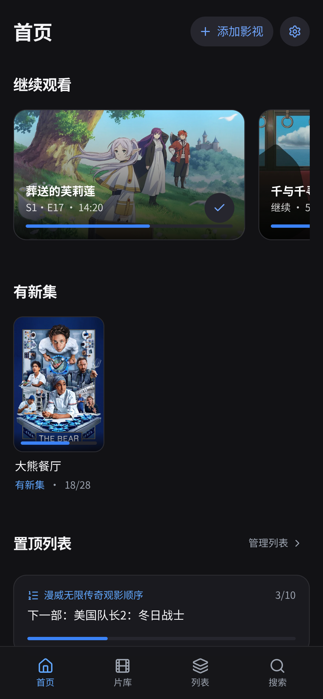
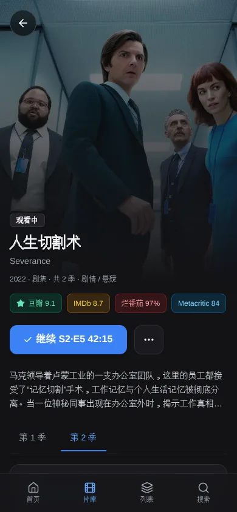
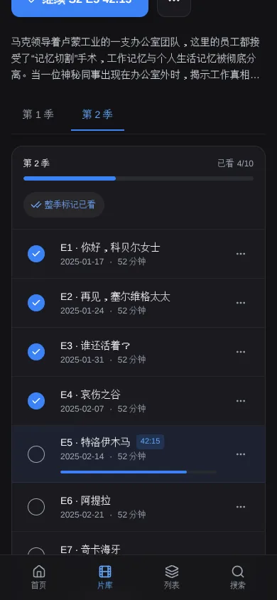
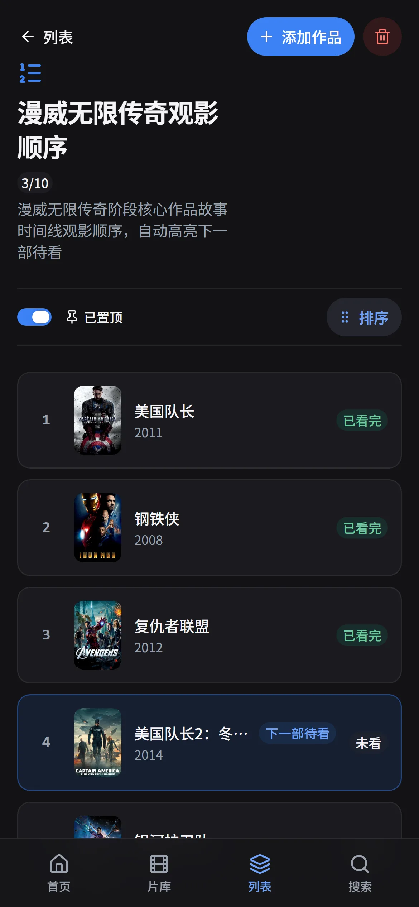
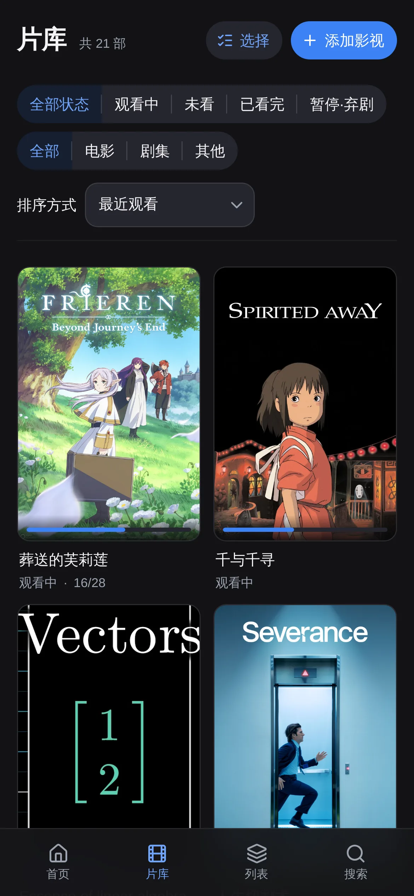
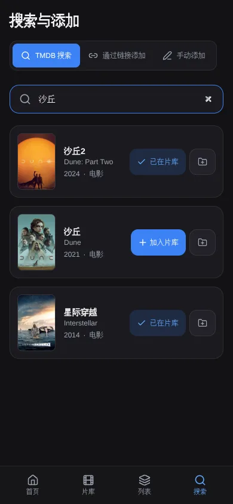
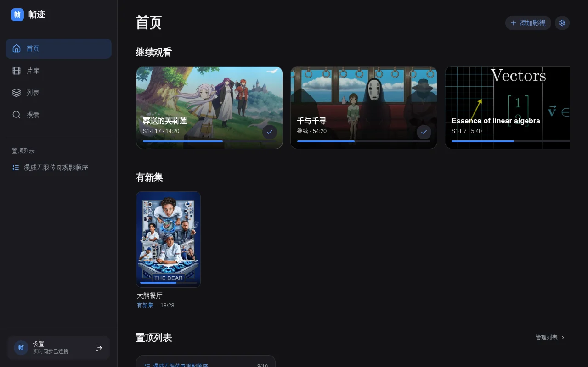
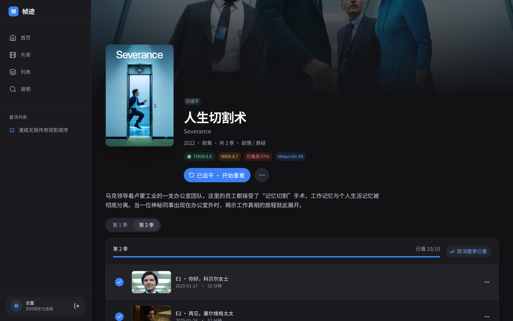

<div align="center">

# 帧迹 Zhenji

**个人自托管的电影与剧集观看进度追踪应用 —— 影院级视觉、单文件 SQLite 便携存储、多端实时同步。**

[](https://react.dev/)
[](https://www.typescriptlang.org/)
[](https://nodejs.org/api/sqlite.html)
[](./Dockerfile)
[](./LICENSE)

**简体中文** | [English](./README.en.md)

</div>

---

## 界面预览

### 手机端（390×844 · `@2x`）

| 首页（深色） | 剧集详情（海报流光） | 剧集分集进度 |
| :---: | :---: | :---: |
|  |  |  |

| 顺序片单（漫威观影顺序） | 个人片库 | 搜索与添加 | 首页（浅色） |
| :---: | :---: | :---: | :---: |
|  |  |  |  |

### 桌面端（1440×900）

<p align="center">
  
</p>
<p align="center">
  
</p>

---

## 功能特性

### 进度追踪
- **纯函数实时状态推导**：绝不存储易过期的派生状态，所有状态（`未开播` / `未看` / `观看中` / `已追平` / `已看完` / `暂停` / `弃剧`）均根据分集开播日期与勾选记录实时计算。
- **追剧感知与「有新集」提醒**：连载剧追平后显示「已追平」；当后续剧集开播后自动转为「观看中」并点亮 **有新集** 徽标。
- **高效批量操作**：支持单集勾选、整季一键标记/取消、「标记到此集」（自动勾选当前集及之前所有已开播剧集，不会误取消后续集）、整部标记已看；未开播剧集自动禁用防误触。
- **精确时间点记录**：支持为电影或当前剧集记录 `mm:ss` / `h:mm:ss` 观看位置（如 `S2·E5 · 42:15`），勾选该集已看后自动清除断点。
- **多刷历史（二刷 / N 刷）**：已看完或已追平的作品可开启新一轮重看，完整保留历次观看起止时间（「看过 2 次」），重看中途也可随时取消并恢复上一轮记录。

### 列表
- **顺序片单 (Ordered List)**：适合「漫威电影宇宙观看顺序」等系列片单，自动高亮第一部尚未看完的作品，并在首页置顶卡片展示下一部待看与总进度。
- **收藏合集 (Collection)**：海报墙视图，支持按添加时间、名称、年份、评分或手动拖拽排序。
- **分数索引单行排序**：基于 `fractional-indexing` 与 `@dnd-kit`，移动端长按手柄拖拽排序每次仅更新单行记录。

### 数据来源
- **TMDB 主数据源**：自动获取中英双语标题、原始片名、分季分集信息、开播日期、剧照与海报，打开详情页时按策略自动刷新连载元数据。
- **多平台评分聚合**：结合 OMDb 获取 IMDb 评分、烂番茄 (Rotten Tomatoes) 与 Metacritic 评分（7 天缓存，按需拉取不消耗多余配额）；支持豆瓣评分尽力匹配、手动填写豆瓣评分/链接与一键跳转豆瓣搜索。
- **链接解析与自定义条目**：支持通过 YouTube (oEmbed) 或哔哩哔哩 (Bilibili / Open Graph) 视频链接一键解析标题与封面，或手动创建任意自定义影视条目。

### 同步与安全
- **多端实时同步 (SSE)**：服务端基于单调递增版本号 (`version`) 与进程纪元 (`epoch`) 通过 Server-Sent Events 实时推送变更；乐观更新配合原子事务接口，快速连点不同剧集绝不互相覆盖。
- **强一致性在线策略**：为彻底杜绝多设备离线缓存冲突，当与服务端断开连接超过 5 秒时将全屏锁定编辑，重连后自动拉取最新快照。
- **单用户密码与多重防护**：`node:crypto` `scrypt` 随机盐哈希、`timingSafeEqual` 恒定时间比对、首次运行一次性设置码验证、登录失败 IP 与全局双重限流、以及 SSRF 内网地址拦截。

### 界面
- **响应式影院级设计**：灵感源自 Infuse 与 Apple TV，移动端底部安全区导航栏、平板侧边导轨、桌面端侧边栏与置顶列表快捷入口。
- **主题与个性化**：默认深色影院模式，支持浅色模式与跟随系统；支持全局/单作品标题语言切换、是否计入特别篇 (Season 0)、首页模块开关与拖拽排序。
- **PWA 桌面/主屏安装**：符合 Web App Manifest 规范，可添加到手机主屏幕全屏独立运行（Service Worker 仅缓存应用外壳，绝不缓存 `/api/*` 数据）。

---

## 快速开始（本地开发）

### 环境要求
- **Node.js `>= 22.13.0`**（推荐使用 **Node.js 24 LTS**；`node:sqlite` 内置模块自 Node.js `22.13.0` 起无需任何实验性命令行标志即可直接使用）
- **npm `>= 10`**

### 启动步骤

```bash
# 1. 克隆仓库
git clone https://github.com/KingCrimsonJY/zhenji.git
cd zhenji

# 2. 复制环境变量模板并填入 TMDB_READ_TOKEN
cp .env.example .env

# 3. 安装依赖
npm install

# 4. 启动开发服务器（默认监听 http://localhost:3000）
npm run dev
```

### 首次启动设置密码
首次启动且数据库尚未设置密码时，终端日志会打印一行**一次性设置码**：

```text
[Auth] First-run setup code: X7k9Pq2mR4vL
```

打开浏览器访问 `http://localhost:3000`，输入终端里显示的设置码（或 `.env` 中预设的 `SETUP_CODE`）并设置至少 10 个字符的访问密码即可进入应用。

> 如需生成包含示例影视与进度的演示数据库（写入 `./data-demo`，不会影响 `./data`），可运行 `npm run seed:demo`。

---

## 配置说明

所有配置项均位于服务端 `.env` 文件中（参考 [`.env.example`](./.env.example)）：

| 变量名 | 必填 | 默认值 | 用途说明 | 获取方式 / 备注 |
| :--- | :---: | :--- | :--- | :--- |
| `TMDB_READ_TOKEN` | **推荐** | 空 | TMDB API v4 读访问令牌（Bearer 认证），用于搜索影视与获取分季分集元数据 | 在 [TMDB 开发者设置](https://www.themoviedb.org/settings/api) 免费申请 API Read Access Token |
| `OMDB_API_KEY` | 可选 | 空 | 按 IMDb ID 查询 IMDb、烂番茄、Metacritic 评分（详情页按需请求并缓存 7 天） | 在 [omdbapi.com/apikey.aspx](https://www.omdbapi.com/apikey.aspx) 免费申请（1,000 次/天） |
| `DATA_DIR` | 可选 | `./data` | SQLite 数据库、自动备份与每日 JSON 导出的统一存储目录 | Docker 容器内固定为 `/data` |
| `SETUP_CODE` | 可选 | 随机生成 | 首次启动设置密码时要求输入的一次性验证设置码 | 留空时会在服务端启动日志中自动生成并打印 |
| `APP_PASSWORD_HASH` | 可选 | 空 | 覆盖数据库密码的 `scrypt` 哈希值（用于重置忘记的密码） | 通过 `npm run set-password -- "新密码"` 生成 |
| `TRUST_PROXY` | 可选 | `0` | 设为 `1` 时信任反代头（`CF-Connecting-IP` / `X-Forwarded-For`）以准确按客户端 IP 限流 | 使用 Cloudflare Tunnel 或 Nginx 反代时设为 `1` |
| `PORT` | 可选 | `3000` | Node.js 服务端监听端口 | 本地或容器内默认 `3000` |

---

## 部署

使用 Docker Compose 即可在两分钟内完成自托管部署：

```bash
git clone https://github.com/KingCrimsonJY/zhenji.git
cd zhenji
cp .env.example .env
# 编辑 .env 填入 TMDB_READ_TOKEN 等配置
docker compose up -d --build

# 查看首次启动的一次性设置码
docker compose logs zhenji | grep "First-run setup code"
```

默认配置将服务绑定在宿主机 `127.0.0.1:8080:3000`，并内置 `cloudflare`（Cloudflare Tunnel）与 `tailscale`（Tailscale Funnel）两个可选 Compose Profile。完整的 Linux 环境配置、隧道接入、版本升级、密码重置与防休眠设置请参阅 **[《部署指南》(docs/deployment.md)](./docs/deployment.md)**。

---

## 数据与备份

所有持久化数据全部保存在单一文件夹 `DATA_DIR`（默认 `./data`）中，不依赖任何外部数据库服务，也不在目录外写入任何文件：

```text
data/
  tracker.db                                    # 主 SQLite 数据库（开启 WAL 与外键级联）
  backups/tracker-YYYY-MM-DD.db                 # 每日自动 VACUUM INTO 快照（保留最新 14 份）
  backups/tracker-YYYY-MM-DD-HHmmss-pre-*.db    # 数据库迁移或导入前的安全快照（保留最新 10 份）
  exports/zhenji-YYYY-MM-DD.json                # 每日原子写入的 JSON 全量导出（保留最新 14 份）
```

- **迁移到新机器**：只需停止容器，将 `./data` 文件夹与 `.env` 复制到新机器，启动同一个 Docker 镜像即可无缝衔接。
- **恢复备份**：既可以在停止容器后用 `backups/*.db` 替换 `tracker.db`，也可以在应用「设置 → 导入数据 (JSON)」中直接上传 `exports/*.json` 恢复。
- **导出文件格式**：完整的 JSON 导出结构与跨版本兼容规范请参阅 **[《数据导出格式说明》(docs/data-format.md)](./docs/data-format.md)**。

---

## 安全说明

- **单密码认证与 `scrypt` 哈希**：无繁琐的多账号体系；密码通过 `node:crypto` 的 `scrypt` 算法加随机盐哈希存储，并使用 `timingSafeEqual` 防止时序攻击。
- **首次启动防抢注**：首次启动必须提供服务端生成的 `SETUP_CODE` 才能设置初始密码；密码一旦设置，初始化接口立即永久关闭。
- **会话与 CSRF 防护**：登录后签发 32 字节随机令牌，服务端仅在 `sessions` 表存储其 SHA-256 哈希，通过 `HttpOnly; SameSite=Lax` Cookie（生产环境启用 `Secure`）下发，有效期 365 天并在活跃时自动续期；所有 Cookie 认证的写请求均强制校验同源 `Origin`。
- **登录限流**：单 IP 15 分钟内最多允许 5 次失败尝试，且设有全局失败阈值保护，防止分布式暴力破解。
- **请始终通过 HTTPS 访问**：暴露到公网或局域网外时，请务必配合 Cloudflare Tunnel、Tailscale Funnel 或反向代理启用 HTTPS。
- **禁用离线模式**：为确保多端进度强一致，应用不支持离线编辑；网络中断时将立即提示并阻止写入。

---

## 项目结构

```text
.
├── server.ts                  # Express + Vite 开发/生产统一入口与定时备份调度
├── server/
│   ├── app.ts                 # 认证、会话、CSRF 校验、SSE 广播与中间件组装
│   ├── auth.ts                # scrypt 哈希、Cookie 工具与登录限流器
│   ├── entityRoutes.ts        # 片库、分季、进度、原子动作、列表、设置、导入导出路由
│   ├── providerRoutes.ts      # TMDB 搜索/详情、OMDb/豆瓣评分、外链解析路由
│   ├── db/                    # SQLite 仓储层、事务封装、自动备份与 SQL 迁移文件
│   ├── providers/             # TMDB、豆瓣（尽力匹配）、外链导入与 SSRF 防护
│   └── scripts/               # set-password 密码重置与 seed-demo 演示数据脚本
├── src/
│   ├── domain/                # 纯函数业务核心（进度状态推导、时间解析、Zod 校验与类型定义）
│   ├── data/                  # 外部状态存储 (useSyncExternalStore)、乐观更新动作与 API 封装
│   ├── context/               # React 上下文、SSE 实时连接与多端状态同步
│   ├── pages/                 # 首页、片库、列表、列表详情、剧集详情、搜索、设置页面
│   ├── features/              # 按页面拆分的子模块组件
│   └── i18n/                  # 简体中文界面文案集中管理 (zh.ts)
└── docs/
    ├── deployment.md          # Linux + Docker Compose 完整部署与运维指南
    ├── data-format.md         # JSON 导出与导入数据格式规范
    └── screenshots/           # 界面实机截图 (WebP)
```

---

## 开发与测试

```bash
# 启动前后端热重载开发服务器 (http://localhost:3000)
npm run dev

# 运行 TypeScript 严格模式类型检查
npm run lint

# 运行 Vitest 单元测试与集成测试（纯函数进度推导、SQLite 仓储、API 路由、SSRF 防护、乐观并发）
npm test

# 构建生产环境前端静态资源至 dist/
npm run build

# 以生产模式启动服务端
npm start

# 生成密码重置哈希
npm run set-password -- "your-new-password"

# 生成演示数据库至 ./data-demo（不会修改 ./data）
npm run seed:demo
```

---

## 致谢与数据来源

<p>
  <a href="https://www.themoviedb.org/" target="_blank" rel="noopener noreferrer">
    
  </a>
</p>

> **This product uses the TMDB API but is not endorsed or certified by TMDB.**

- **[The Movie Database (TMDB)](https://www.themoviedb.org/)**：提供影视搜索、多语言标题、分季分集元数据以及海报与剧照图片。
- **[OMDb API](https://www.omdbapi.com/)**：提供 IMDb、Rotten Tomatoes 与 Metacritic 评分数据。
- **豆瓣 (Douban)**：应用内的豆瓣自动查询为非官方尽力解析（Best-effort），仅供个人自托管学习与观影记录使用；若自动获取失败，随时可通过详情页手动填写评分或点击「在豆瓣搜索」跳转。
- **开源社区项目**：感谢 [React](https://react.dev/)、[HeroUI v3](https://heroui.com/)、[Tailwind CSS v4](https://tailwindcss.com/)、[@dnd-kit](https://dndkit.com/)、[Lucide Icons](https://lucide.dev/) 与 [Zod](https://zod.dev/)。

---

## 许可证

本项目基于 [MIT License](./LICENSE) 开源，Copyright (c) 2026 KingCrimsonJY。
